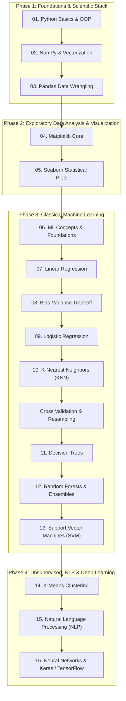

# 🚀 Machine Learning: Zero to Hero

<p align="center">
  
  
  
  
  
  
</p>

<p align="center">
  <strong>A comprehensive, project-driven, masterclass repository taking you from Python fundamentals to Deep Learning.</strong><br>
  Includes 34 sequential Jupyter Notebooks, hands-on exercises with complete solutions, real-world datasets, and 17 accompanying PDF slide decks.
</p>

---

## 📌 Table of Contents

- [Overview](#-overview)
- [Curriculum Roadmap](#-curriculum-roadmap)
- [Repository Structure & Navigation Guide](#-repository-structure--navigation-guide)
  - [How the Repository is Organized](#how-the-repository-is-organized)
  - [Folder-by-Folder Guide](#folder-by-folder-guide)
  - [Recommended Learning Paths](#recommended-learning-paths)
- [Curriculum Breakdown](#-curriculum-breakdown)
- [Datasets Included](#-datasets-included)
- [Supplementary Materials](#-supplementary-materials)
- [Environment Setup & Installation](#-environment-setup--installation)
  - [Quick Start: One-Command Setup](#1-quick-start-one-command-conda-setup)
  - [Installing Miniconda (If Needed)](#2-installing-miniconda)
  - [Setting Up Jupyter in VS Code](#3-setting-up-jupyter--vs-code)
- [Tips for Getting the Most Out of This Repo](#-tips-for-getting-the-most-out-of-this-repo)
- [Contributing & Support](#-contributing--support)

---

## 📖 Overview

**Machine Learning: Zero to Hero** is designed as a structured, self-paced curriculum. Whether you are an absolute beginner writing your first lines of Python or an aspiring data scientist looking to master supervised learning, unsupervised clustering, NLP, and neural networks, this repository provides:

1. **Structured Progression:** Every notebook is sequentially numbered (`1` through `34`) across modular directories.
2. **Theory + Practice:** Each major algorithmic topic includes conceptual notebooks/slides followed by real-world exercises and solution notebooks.
3. **Included Datasets:** All datasets required for exercises and mini-projects are included directly inside the repository.
4. **Lecture Slides:** A dedicated `pdfs/` folder contains comprehensive slide decks accompanying every topic.

---

## 🗺 Curriculum Roadmap



---

## 📂 Repository Structure & Navigation Guide

### How the Repository is Organized

To make progression intuitive, folders and notebooks follow a consistent convention:

- **Numbered Folders:** Folders `1_Python` through `16_Neural_Networks` plus `Cross_Validation` represent thematic modules in the learning journey.
- **Numbered Notebooks (`1_` to `34_`):** Notebooks are sequentially indexed across the entire repository. This guarantees that you always know what to study next.
- **Theory $\to$ Exercise $\to$ Solution Pattern:**
  - `*_Intro_*.ipynb` or `*_Art_of_*.ipynb`: Conceptual walkthroughs with code snippets.
  - `*_exercise.ipynb` or `*_Exercise.ipynb`: Prompt files with missing code cells for hands-on practice.
  - `*_solutions.ipynb`: Full solution keys to verify your implementations.
- **Local Datasets:** Datasets are placed directly in the relevant module folder or subfolder.
- **Lecture Notes:** The `pdfs/` folder contains matching slide decks for quick review before coding.

---

### Folder-by-Folder Guide

Below is a detailed inventory of every directory, what it contains, and how to use it:

| # | Folder | Primary Contents | Key Topics & Description | Datasets & Artifacts |
|---|---|---|---|---|
| **01** | [`1_Python/`](./1_Python/) | `1_python_for_ML.ipynb`<br>`simple_command_line_todo_app.py` | Python syntax, data structures (lists, dicts, sets, tuples), functions, control flow, file I/O, OOP, and an SQLite-backed terminal CLI project. | Built-in SQLite database |
| **02** | [`2_Numpy/`](./2_Numpy/) | `2_Intro_Into_numpy.ipynb`<br>`3_exercise.ipynb`<br>`4_exercise_solutions.ipynb` | N-dimensional arrays, vectorization, slicing/indexing, broadcasting, array math, and universal functions. | Exercises & solutions |
| **03** | [`3_Pandas/`](./3_Pandas/) | `5_Intro_into_Pandas.ipynb`<br>`6_exercise.ipynb`<br>`7_exercise_Solutions.ipynb` | Series, DataFrames, missing data handling, GroupBy aggregations, merging/joining, time series, and file reading. | `resources/Ecommerce`, `test.csv`, `test.db` |
| **04** | [`4_MatplotLib/`](./4_MatplotLib/) | `8_Data_Visualization_with_matplotlib.ipynb`<br>`9_exercise copy.ipynb`<br>`10_exercise_solution.ipynb` | Functional vs. Object-Oriented plotting APIs, subplots, figure sizing, DPI, canvas styling, and legends. | Generated plot artifacts |
| **05** | [`5_Seaborn/`](./5_Seaborn/) | `11_Data_Visualization_with_Seaborn.ipynb`<br>`12_exercise.ipynb`<br>`13_exercise_solutions.ipynb` | Statistical data plotting: distribution plots, categorical plots, matrix/heatmaps, pairplots, and FacetGrids. | Seaborn built-in datasets |
| **06** | [`6_Introduction_Machine_learning/`](./6_Introduction_Machine_learning/) | `14_A_Small_Introduction_to_Machine_Learning.ipynb` | High-level ML taxonomy: Supervised vs. Unsupervised vs. Reinforcement Learning, workflow, and model lifecycle. | Conceptual diagrams |
| **07** | [`7_Linear_Regression/`](./7_Linear_Regression/) | `15_Art_of_Regression.ipynb`<br>`16_A_Simple_Project.ipynb`<br>`17_A_Simple_Project_Solutions.ipynb` | Cost functions, Ordinary Least Squares (OLS), Scikit-Learn LinearRegression, evaluation metrics ($R^2$, MAE, MSE, RMSE). | `USA_Housing.csv`<br>`Ecommerce Customers`<br>`house_price_bd.csv` |
| **08** | [`8_Bias_Variance/`](./8_Bias_Variance/) | `18_Bias.ipynb` | Understanding the bias-variance dilemma, underfitting vs. overfitting, and model complexity curves. | Synthetic regression plots |
| **09** | [`9_Logistic_Regression/`](./9_Logistic_Regression/) | `19_Logistic_Regression.ipynb`<br>`20_A_Simple_Project_Exercise.ipynb`<br>`21_A_Simple_Project_Solutions.ipynb` | Sigmoid function, odds ratios, binary classification, confusion matrices, classification reports, and ROC/AUC. | `advertising.csv`<br>`titanic_train.csv`<br>`titanic_test.csv` |
| **10** | [`10_k_Nearest_Neighbor/`](./10_k_Nearest_Neighbor/) | `22_K_Nearest_NeighBor.ipynb`<br>`23_A_Simple_Project_Exercise.ipynb`<br>`24_A_Simple_Project_Solution.ipynb` | Distance metrics (Euclidean, Manhattan), feature scaling (StandardScaler), choosing $K$ via the elbow error rate. | `Classified Data`<br>`KNN_Project_Data`<br>`diabetes.csv` |
| **11** | [`Cross_Validation/`](./Cross_Validation/) | `25_Corss_Validation.ipynb` | K-Fold cross validation, Stratified K-Fold, train-test-validation splits, cross-val scoring, avoiding data leakage. | Synthetic / Sklearn datasets |
| **12** | [`11_Decision_Trees/`](./11_Decision_Trees/) | `26_Decision_Trees.ipynb` | Tree algorithms, Entropy, Information Gain, Gini Impurity, recursive binary splitting, tree pruning, visualization. | `kyphosis.csv`<br>`loan_data.csv` |
| **13** | [`12_Random_Forest/`](./12_Random_Forest/) | `27_Random_Forest.ipynb`<br>`28_Project_on_Random_Forest_and_Decison_Tree.ipynb` | Ensemble methods, Bagging (Bootstrap Aggregation), feature subsampling, performance comparison vs. single decision trees. | `kyphosis.csv`<br>`loan_data.csv` |
| **14** | [`13_Support_Vector_Machine/`](./13_Support_Vector_Machine/) | `29_Support_Vector_Machine.ipynb` | Maximal margin hyperplanes, support vectors, margin soft constraints ($C$), kernel trick (Linear, Polynomial, RBF, Gamma). | Breast Cancer dataset |
| **15** | [`14_K_Means_Clustering/`](./14_K_Means_Clustering/) | `30_K_Means_Clustering.ipynb`<br>`31_a_simple_project.ipynb` | Unsupervised learning, cluster centroids, inertia, elbow method, clustering universities without labels. | `College_Data` |
| **16** | [`15_Natural_language_Processing/`](./15_Natural_language_Processing/) | `32_Introduction_To_NLP.ipynb`<br>`33_A_Simple_Project.ipynb` | Text pre-processing, stop-word removal, tokenization, Bag-of-Words, TF-IDF vectorization, scikit-learn Pipelines. | `SMSSpamCollection`<br>`yelp.csv`<br>`Fake_News/` (`Fake.csv`, `True.csv`) |
| **17** | [`16_Neural_Networks/`](./16_Neural_Networks/) | `34_Introduction_to_Neural_Networks.ipynb` | Artificial Neural Networks (ANN), Perceptrons, activation functions (ReLU, Sigmoid), backprop, Keras/TensorFlow model building. | `custom_price_dataset.csv`<br>`first_model.keras` |
| **—** | [`pdfs/`](./pdfs/) | 17 presentation files (`1_python_for_ML.pdf` to `17_Introduction_to_Neural_Networks.pdf`) | Lecture slides and structured visual notes for every topic. Perfect for quick revision and presentations. | 17 slide decks (PDF) |

---

### Recommended Learning Paths

Choose the path that best matches your background:

#### 1. 🎓 The Complete "Zero-to-Hero" Path (Recommended for Beginners)
> **Goal:** Build rock-solid fundamentals before tackling machine learning models.
1. Start with [`1_Python`](./1_Python/) and work through [`5_Seaborn`](./5_Seaborn/).
2. Read the corresponding theory PDF in [`pdfs/`](./pdfs/) before opening each module.
3. Solve all exercise notebooks (`3_exercise.ipynb`, `6_exercise.ipynb`, etc.) on your own before checking the solutions.
4. Proceed sequentially from `6_Introduction_Machine_learning` through `16_Neural_Networks`.

#### 2. ⚡ The Data Science Fast-Track (For Python / Data Wranglers)
> **Goal:** Skip syntax review and jump directly into ML algorithms and models.
1. Quick refresh: skim [`pdfs/6_A_Small_Introduction_to_Machine_Learning.pdf`](./pdfs/6_A_Small_Introduction_to_Machine_Learning.pdf).
2. Begin directly at [`7_Linear_Regression`](./7_Linear_Regression/).
3. Make sure to complete the [`Cross_Validation`](./Cross_Validation/) notebook before tree-based algorithms.
4. Finish with [`15_Natural_language_Processing`](./15_Natural_language_Processing/) and [`16_Neural_Networks`](./16_Neural_Networks/).

#### 3. 💼 The Project-Only Portfolio Track (For Practical Application)
> **Goal:** Build end-to-end projects for your portfolio or interview preparation.
- **Regression:** [`7_Linear_Regression/16_A_Simple_Project.ipynb`](./7_Linear_Regression/16_A_Simple_Project.ipynb) (E-Commerce Customer Spending)
- **Classification:** [`9_Logistic_Regression/20_A_Simple_Project_Exercise.ipynb`](./9_Logistic_Regression/20_A_Simple_Project_Exercise.ipynb) (Advertising Click Prediction & Titanic Survival)
- **KNN Classification:** [`10_k_Nearest_Neighbor/23_A_Simple_Project_Exercise.ipynb`](./10_k_Nearest_Neighbor/23_A_Simple_Project_Exercise.ipynb)
- **Ensemble Learning:** [`12_Random_Forest/28_Project_on_Random_Forest_and_Decison_Tree.ipynb`](./12_Random_Forest/28_Project_on_Random_Forest_and_Decison_Tree.ipynb) (LendingClub Loan Repayment)
- **Unsupervised Clustering:** [`14_K_Means_Clustering/31_a_simple_project.ipynb`](./14_K_Means_Clustering/31_a_simple_project.ipynb) (University Segmentation)
- **Text Classification / NLP:** [`15_Natural_language_Processing/33_A_Simple_Project.ipynb`](./15_Natural_language_Processing/33_A_Simple_Project.ipynb) (Yelp Sentiment & Fake News Detection)
- **Deep Learning:** [`16_Neural_Networks/34_Introduction_to_Neural_Networks.ipynb`](./16_Neural_Networks/34_Introduction_to_Neural_Networks.ipynb) (Custom Pricing Model in Keras)

---

## 📊 Curriculum Breakdown

| Index | Topic / Notebook | Key Concepts | Hands-On Exercise / Project | PDF Slide Deck |
|:---:|---|---|---|:---:|
| **01** | `1_python_for_ML` | Variables, collections, control flow, functions, OOP | SQLite CLI To-Do App | [Slide 01](./pdfs/1_python_for_ML.pdf) |
| **02** | `2_Intro_Into_numpy` | Arrays, indexing, slicing, broadcasting, vectorized ops | Exercises + Solutions (03 & 04) | [Slide 02](./pdfs/2_Intro_Into_numpy.pdf) |
| **03** | `5_Intro_into_Pandas` | DataFrames, Series, missing data, GroupBy, merges | Exercises + Solutions (06 & 07) | [Slide 03](./pdfs/3_Intro_into_Pandas.pdf) |
| **04** | `8_Data_Visualization_with_matplotlib` | Plots, subplots, figure size, DPI, styling | Exercises + Solutions (09 & 10) | [Slide 04](./pdfs/4_Data_Visualization_with_matplotlib.pdf) |
| **05** | `11_Data_Visualization_with_Seaborn` | Distribution, categorical, matrix, regression plots | Exercises + Solutions (12 & 13) | [Slide 05](./pdfs/5_Data_Visualization_with_Seaborn.pdf) |
| **06** | `14_A_Small_Introduction_to_Machine_Learning` | Supervised, unsupervised, workflow, train-test split | Conceptual Overview | [Slide 06](./pdfs/6_A_Small_Introduction_to_Machine_Learning.pdf) |
| **07** | `15_Art_of_Regression` | Cost functions, Ordinary Least Squares, Scikit-Learn | E-commerce Project (16 & 17) | [Slide 07](./pdfs/7_Art_of_Regression.pdf) |
| **08** | `18_Bias` | Bias-variance tradeoff, overfitting, underfitting | Model Complexity Analysis | [Slide 08](./pdfs/8_Bias.pdf) |
| **09** | `19_Logistic_Regression` | Sigmoid, odds, classification evaluation, confusion matrix | Advertising & Titanic (20 & 21) | [Slide 09](./pdfs/9_Logistic_Regression.pdf) |
| **10** | `22_K_Nearest_NeighBor` | Distance metric, feature scaling, choosing optimal K | KNN Project (23 & 24) | [Slide 10](./pdfs/10_K_Nearest_Neighbor.pdf) |
| **11** | `25_Corss_Validation` | K-Fold, Stratified K-Fold, validation leakage prevention | Resampling experiments | [Slide 11](./pdfs/11_Corss_Validation.pdf) |
| **12** | `26_Decision_Trees` | Entropy, Information Gain, Gini index, tree splits | Kyphosis & Loan Data Analysis | [Slide 12](./pdfs/12_Decision_Trees.pdf) |
| **13** | `27_Random_Forest` | Ensemble learning, bagging, feature subsampling | Tree vs. Forest Comparison (28) | [Slide 13](./pdfs/13_Random_Forest.pdf) |
| **14** | `29_Support_Vector_Machine` | Margin maximization, support vectors, RBF/kernel trick | Cancer Classification | [Slide 14](./pdfs/14_Support_Vector_Machine.pdf) |
| **15** | `30_K_Means_Clustering` | Unsupervised centroids, inertia, elbow curve | College Data Project (31) | [Slide 15](./pdfs/15_K_Means_Clustering.pdf) |
| **16** | `32_Introduction_To_NLP` | Bag-of-Words, TF-IDF, CountVectorizer, Pipelines | NLP Spam & Yelp Project (33) | [Slide 16](./pdfs/16_Introduction_To_NLP.pdf) |
| **17** | `34_Introduction_to_Neural_Networks` | Perceptron, backprop, Dense layers, Keras sequential API | Custom Price Prediction Model | [Slide 17](./pdfs/17_Introduction_to_Neural_Networks.pdf) |

---

## 💾 Datasets Included

All datasets required to run and experiment with the notebooks are bundled directly in this repository:

| Dataset | Location | Used In | Description / Target |
|---|---|---|---|
| `Ecommerce Customers` | [`7_Linear_Regression/`](./7_Linear_Regression/) | Linear Regression | Customer engagement time (App, Website, Membership) vs. Yearly Spend |
| `USA_Housing.csv` | [`7_Linear_Regression/`](./7_Linear_Regression/) | Linear Regression | House features (Area income, rooms, bedrooms, population) vs. Price |
| `house_price_bd.csv` | [`7_Linear_Regression/`](./7_Linear_Regression/) | Linear Regression | Real estate housing price dataset from Bangladesh |
| `advertising.csv` | [`9_Logistic_Regression/`](./9_Logistic_Regression/) | Logistic Regression | Predict whether an internet user will click on an ad |
| `titanic_train.csv` / `test` | [`9_Logistic_Regression/`](./9_Logistic_Regression/) | Logistic Regression | Legendary Kaggle dataset predicting passenger survival |
| `Classified Data` | [`10_k_Nearest_Neighbor/`](./10_k_Nearest_Neighbor/) | K-Nearest Neighbors | Anonymized feature columns for binary classification |
| `KNN_Project_Data` | [`10_k_Nearest_Neighbor/`](./10_k_Nearest_Neighbor/) | K-Nearest Neighbors | Feature matrix for KNN practice |
| `diabetes.csv` | [`10_k_Nearest_Neighbor/`](./10_k_Nearest_Neighbor/) | K-Nearest Neighbors | Pima Indians Diabetes classification |
| `kyphosis.csv` | [`11_Decision_Trees/`](./11_Decision_Trees/), [`12_Random_Forest/`](./12_Random_Forest/) | Decision Trees & Random Forests | Medical dataset predicting post-operative spinal condition |
| `loan_data.csv` | [`11_Decision_Trees/`](./11_Decision_Trees/), [`12_Random_Forest/`](./12_Random_Forest/) | Decision Trees & Random Forests | LendingClub dataset predicting loan repayment default |
| `College_Data` | [`14_K_Means_Clustering/`](./14_K_Means_Clustering/) | K-Means Clustering | US university statistics (private vs. public clustering) |
| `SMSSpamCollection` | [`15_Natural_language_Processing/`](./15_Natural_language_Processing/) | NLP | SMS text messages labeled as spam or ham |
| `yelp.csv` | [`15_Natural_language_Processing/`](./15_Natural_language_Processing/) | NLP | Yelp business reviews and star ratings |
| `Fake.csv` / `True.csv` | [`15_Natural_language_Processing/Fake_News/`](./15_Natural_language_Processing/Fake_News/) | NLP | Full-length news articles labeled real vs. fake news |
| `custom_price_dataset.csv` | [`16_Neural_Networks/`](./16_Neural_Networks/) | Deep Learning | Synthetic pricing dataset for neural network training |

---

## 📚 Supplementary Materials

### 1. Lecture Slide Decks (`pdfs/`)
The [`pdfs/`](./pdfs/) folder contains **17 PDF slide presentations** mirroring each module. Use them to:
- Review the core mathematical foundations and architectural diagrams before running code.
- Prepare lecture or presentation slides for study groups or classes.

---

## ⚙️ Environment Setup & Installation

### 1. Quick Start: One-Command Conda Setup

The entire scientific Python environment is pre-configured in [`environment.yml`](./environment.yml). It installs Python 3.11, NumPy, Pandas, Matplotlib, Seaborn, Scikit-Learn, TensorFlow, Keras, and Jupyter Notebook.

Clone the repository and recreate the environment:

```bash
# Clone the repository
git clone https://github.com/RishatTalukder/Machine-Learning-Zero-to-Hero.git
cd Machine-Learning-Zero-to-Hero

# Create the conda environment
conda env create -f environment.yml

# Activate the environment
conda activate ml_env
```

---

### 2. Installing Miniconda

If you do not have `conda` installed yet, we recommend **Miniconda** (lightweight and fast):

#### On Linux / Ubuntu:
```bash
mkdir -p ~/miniconda3
wget https://repo.anaconda.com/miniconda/Miniconda3-latest-Linux-x86_64.sh -O ~/miniconda3/miniconda.sh
bash ~/miniconda3/miniconda.sh -b -u -p ~/miniconda3
rm ~/miniconda3/miniconda.sh

# Initialize conda
~/miniconda3/bin/conda init bash
```
Restart your terminal, and `conda` will be available.

#### On Windows:
1. Download the [Miniconda Windows Installer](https://repo.anaconda.com/miniconda/Miniconda3-latest-Windows-x86_64.exe).
2. Run the installer and ensure you check **"Register Miniconda3 as my default Python"**.
3. Open **Anaconda Prompt** or PowerShell and initialize:
   ```cmd
   conda init
   ```

*(Alternative: You may also install the full [Anaconda Distribution](https://www.anaconda.com/download) if you prefer a GUI desktop experience).*

---

### 3. Setting Up Jupyter & VS Code

For the best developer experience, we recommend using **Visual Studio Code**:

1. Install **VS Code** and open this repository folder:
   ```bash
   code .
   ```
2. Install the **Python** and **Jupyter** extensions from the VS Code Marketplace.
3. Open any notebook (e.g., [`1_Python/1_python_for_ML.ipynb`](./1_Python/1_python_for_ML.ipynb)).
4. Click on the **Kernel Selector** in the top-right corner of the editor.
5. Select **Python Environments...** $\to$ choose **`Python 3.11 (ml_env)`**.

If running standalone Jupyter in your browser:
```bash
conda activate ml_env
jupyter notebook
```

---

## 💡 Tips for Getting the Most Out of This Repo

- ✍️ **Type the code yourself:** Avoid just running cells without reading. Typing builds muscle memory for API signatures and data structures.
- 🧪 **Embrace the exercises:** Resist the urge to peek into `*_solutions.ipynb` immediately. Struggle with the error messages — that is where true learning happens!
- 📈 **Visualize early and often:** When exploring datasets in Pandas, make it a habit to plot distributions and correlations with Seaborn.
- 📐 **Connect theory with practice:** Open the corresponding PDF from [`pdfs/`](./pdfs/) alongside the Jupyter notebook to link the mathematical equations with their Scikit-Learn implementation.

---

## 🤝 Contributing & Support

Contributions, fixes, and improvements are always welcome!

- 🐛 **Found a typo or bug?** Please open an [Issue](https://github.com/RishatTalukder/Machine-Learning-Zero-to-Hero/issues).
- 💡 **Have an enhancement?** Fork the repository, create a branch, and submit a [Pull Request](https://github.com/RishatTalukder/Machine-Learning-Zero-to-Hero/pulls).
- ⭐ **Found this helpful?** Star this repository to support the project and help others discover it!

---

<p align="center">
  Happy Learning & Happy Coding! 🧠✨
</p>
